<!-- ============================================================
     theohsiung / theohsiung — profile README
     Visual system: SVG banner (assets/) + shields for-the-badge section headers.
     GitHub strips CSS, so all design lives in images. Every badge is static
     (no rate-limited stats cards). Palette: #0d1117 · #9f1239 (wine). Banner colors live in scripts/banner.py.
     ============================================================ -->

  <picture>
    <source media="(prefers-color-scheme: dark)" srcset="assets/banner-dark.svg"/>
    
  </picture>

  
  
  

&nbsp;

I work at Delta Electronics in Taiwan and serve as an Associate Research Scientist on the [vLLM Semantic Router](https://github.com/vllm-project/semantic-router) team. I started in **computer vision** (face reenactment, FLAME 3D faces, diffusion avatars, 3D scene text), moved into **LLM serving and routing**, and now work on **AI for Science**: letting a coding agent run the research loop itself. I like working close to the model: simulators, routing, serving, evaluation, and the agent layer on top.

&nbsp;

<table width="100%">
<thead><tr>
  <th width="50%" align="left">🔬 <a href="https://github.com/theohsiung/metaResearch">meta-research</a></th>
  <th width="50%" align="left">🧭 <a href="https://github.com/vllm-project/semantic-router">vLLM Semantic Router</a></th>
</tr></thead>
<tbody><tr>
  <td valign="top">
    An autonomous design-optimization framework. A coding agent proposes a design, scores it against a simulator, reads the diagnostics (for example heatmaps), forms the next falsifiable hypothesis, and repeats. Every result is committed to git as append-only experience.
      
    Generalizes <a href="https://github.com/karpathy/autoresearch">autoresearch</a> and <a href="https://github.com/stanford-iris-lab/meta-harness">meta-harness</a> to parametric engineering design, such as water-cooling cold plates. Ships as a Claude Code skill.
  </td>
  <td valign="top">
    System-level routing for mixture-of-models across cloud, data center and edge. I work across the request lifecycle (<b>signal → decision → algorithm</b>) and on the model runtime that serves the decision models.
      
    Recent work: Vela 3.0 d3 decision models on NVFP4, and <b>vSR</b>, a Claude Code plugin that runs the routing decision model inside the harness.
  </td>
</tr></tbody>
</table>

&nbsp;

<table width="100%">
<tbody><tr>
  <td width="40%" valign="middle">
    
  </td>
  <td valign="middle">
    <a href="https://vllm-sr.ai/blog/vsr-claude-code"><b>vSR: vLLM Semantic Router Inside Claude Code</b></a> 
    vLLM Semantic Router Blog · Nov 10, 2026 · with Abhinav Mahajan
      
    vSR brings vLLM Semantic Router's decision model into Claude Code. It routes subagents to the right model, hides personal data and secrets before Claude reads them, and holds risky Bash commands for you to confirm.
      
    <a href="https://vllm-sr.ai/blog/vsr-claude-code">Read the post ↗</a>
  </td>
</tr></tbody>
</table>

&nbsp;

Selected merged pull requests to [vllm-project/semantic-router](https://github.com/vllm-project/semantic-router), grouped by area:

| Area | What I shipped | Pull requests |
|---|---|---|
| **Model runtime** | Serve the Vela 3.0 d3 decision models, with `vela3-fast` as the default. Load NVFP4 packages, merge NVFP4 projections that share an input, and run FlashInfer's FP4 GEMM inside CUDA graph captures. Record ROCm golden answers. | [#5225](https://github.com/vllm-project/semantic-router/pull/5225) · [#5233](https://github.com/vllm-project/semantic-router/pull/5233) · [#5329](https://github.com/vllm-project/semantic-router/pull/5329) · [#5512](https://github.com/vllm-project/semantic-router/pull/5512) · [#5704](https://github.com/vllm-project/semantic-router/pull/5704) · [#6113](https://github.com/vllm-project/semantic-router/pull/6113) |
| **Agent harness** | **vSR**, a Claude Code plugin that runs the routing decision model inside the harness. | [#5950](https://github.com/vllm-project/semantic-router/pull/5950) · [#6081](https://github.com/vllm-project/semantic-router/pull/6081) |
| **Security** | Pluggable jailbreak classifier backend with a fail-closed contract. Report `risk_score` as P(jailbreak). Fix a cross-tenant leak in the semantic cache and an injection in Milvus memory filters. | [#2759](https://github.com/vllm-project/semantic-router/pull/2759) · [#2930](https://github.com/vllm-project/semantic-router/pull/2930) · [#2594](https://github.com/vllm-project/semantic-router/pull/2594) · [#2135](https://github.com/vllm-project/semantic-router/pull/2135) · [#2139](https://github.com/vllm-project/semantic-router/pull/2139) |
| **Protocol & looper** | The v0.4 `x-vsr-*` response-header protocol. Latency and token-usage reporting for looper calls, a byte ceiling on upstream reads, and SSE frame reassembly for streaming. | [#2212](https://github.com/vllm-project/semantic-router/pull/2212) · [#2218](https://github.com/vllm-project/semantic-router/pull/2218) · [#2229](https://github.com/vllm-project/semantic-router/pull/2229) · [#2697](https://github.com/vllm-project/semantic-router/pull/2697) · [#2580](https://github.com/vllm-project/semantic-router/pull/2580) · [#2323](https://github.com/vllm-project/semantic-router/pull/2323) |
| **Performance** | A looper benchmark and regression-baseline suite, PR gating on allocation regressions, and no duplicate embedding inference on cache misses. | [#2457](https://github.com/vllm-project/semantic-router/pull/2457) · [#2496](https://github.com/vllm-project/semantic-router/pull/2496) · [#2162](https://github.com/vllm-project/semantic-router/pull/2162) |

Elsewhere: [BerriAI/moyai#470](https://github.com/BerriAI/moyai/pull/470) centralizes GitHub trigger action resolution.

<b><a href="https://github.com/vllm-project/semantic-router/pulls?q=is%3Apr+author%3Atheohsiung+is%3Amerged">All merged PRs ↗</a></b>

&nbsp;

| Project | What it is |
|---|---|
| [**theohsiung/metaResearch**](https://github.com/theohsiung/metaResearch) | **AI for Science**: autonomous design-optimization framework (autoresearch + meta-harness) |
| [**vllm-project/semantic-router**](https://github.com/vllm-project/semantic-router) | Intelligent LLM router (Envoy ExtProc), **contributor** |
| [**at2_skills**](https://github.com/theohsiung/at2_skills) | Claude agent skills for office automation |
| [**senior-swe-skills**](https://github.com/theohsiung/senior-swe-skills) | Engineering skills & workflow tooling |
| [**poetiq-arc-agi-solver**](https://github.com/theohsiung/poetiq-arc-agi-solver) | ARC-AGI reasoning solver |

&nbsp;

- [**Syn3DTxt: Embedding 3D Cues for Scene Text Generation**](https://arxiv.org/abs/2505.18479): *CVPR 2025 Workshop (SyntaGen)*. Code: [SynTxt-Gen](https://github.com/theohsiung/SynTxt-Gen)
- [**PASL: Pose-Adapted Shape Learning for Large-Pose Face Reenactment**](https://github.com/theohsiung/CVPR-LargePoseFaceReenactment), with follow-up work on [FLAME](https://github.com/theohsiung/PASL-with-FLAME) and [diffusion avatars](https://github.com/theohsiung/Diffusion_AVATAR)

&nbsp;

  
  
  
  
  
  
  
  
  
  
  

&nbsp;

I build on [@karpathy](https://github.com/karpathy)'s [autoresearch](https://github.com/karpathy/autoresearch), the [Stanford IRIS Lab](https://github.com/stanford-iris-lab)'s [meta-harness](https://github.com/stanford-iris-lab/meta-harness), and the work of the [vLLM](https://github.com/vllm-project) maintainers and the [semantic-router](https://github.com/vllm-project/semantic-router) team. It's a privilege to contribute back.

&nbsp;

  <picture>
    <source media="(prefers-color-scheme: dark)" srcset="https://raw.githubusercontent.com/theohsiung/theohsiung/output/github-snake-dark.svg"/>
    
  </picture>

  <code>propose → simulate → diagnose → hypothesize · commit · repeat</code>

